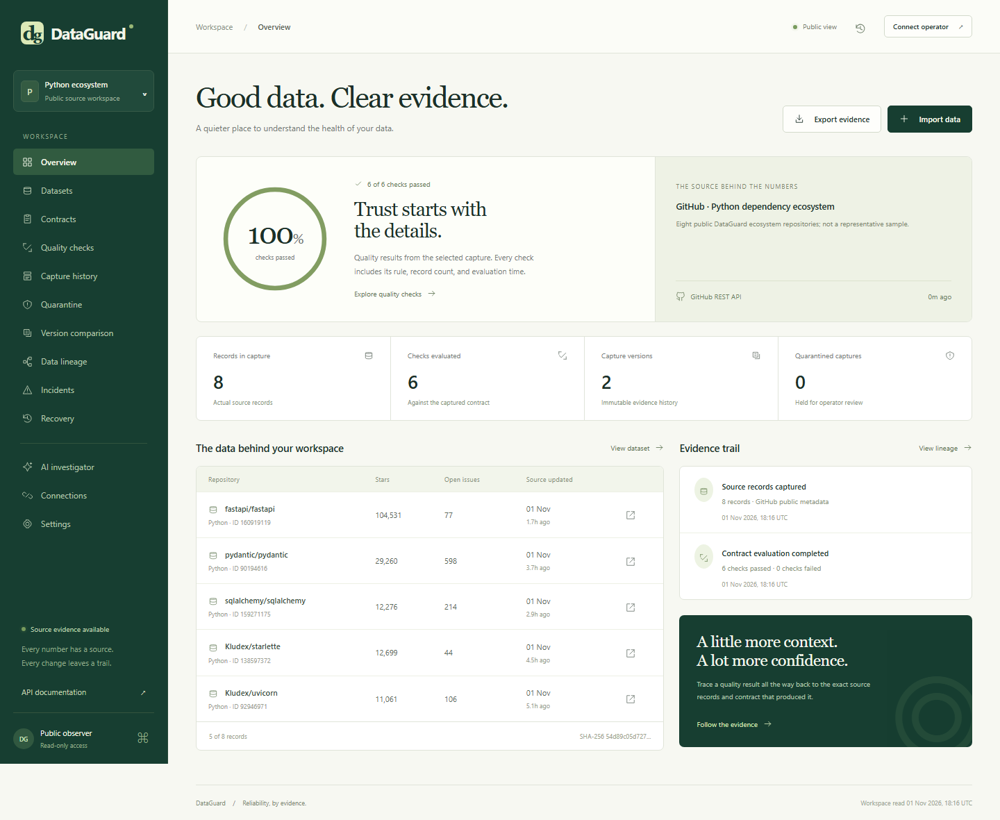
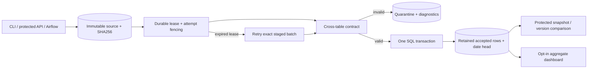

# DataGuard

**A data reliability workspace with real source evidence.** Inspect public GitHub repository metadata, define quality contracts, investigate failed checks, compare immutable captures, and trace every result to its source and SHA-256 digest.

[Live workspace](https://rohith-dataguard.vercel.app) · [Live API docs](https://rohith-dataguard.vercel.app/docs) · [Source](https://github.com/9059Rohith/dataguard) · [Workspace verification](evidence/quality-verification.md)



## Repository quality workspace

The public workspace has 13 separate routes: overview, datasets, contracts, quality checks, capture history, quarantine, version comparison, data lineage, incidents, recovery, AI investigator, connections, and settings. Every visible repository count is sourced from actual GitHub REST responses. The bundled capture was collected on 1 November 2026; capture and evaluation timestamps are displayed, and freshness is re-evaluated explicitly rather than presented as continuously live.

The source is a fixed, bounded collection of eight public repositories: FastAPI, Pydantic, SQLAlchemy, Starlette, Uvicorn, Prometheus Python client, Psycopg, and Pytest. The collection is an intentional Python infrastructure sample, not a representative ecosystem survey. GitHub open issue counts include pull requests. The normalized source records and provenance are committed in `dataguard/source_capture.json`. See the [GitHub repository API](https://docs.github.com/en/rest/repos/repos#get-a-repository).

- Public visitors can inspect source records, filter them, inspect check evidence, compare versions, trace lineage, and export actual JSON evidence.
- Operators connect using the existing `DATAGUARD_TOKEN` bearer credential. It stays in tab memory and clears on reload.
- Operators can sync all eight actual GitHub sources, import up to 500 actual repository records, change a typed contract, re-evaluate captures, add private investigation notes, and select a recovery reference after current-contract validation.
- Uploads and notes are always private. Public captures contain only the fixed GitHub source collection. All mutation requests are authenticated before body parsing.
- A separate SQL schema stores immutable capture documents, contract settings, and audit actions. The existing settlement tables and security boundary are retained. PostgreSQL is used in the hosted deployment.
- Quality checks cover minimum volume, required fields, uniqueness, nonnegative integer counters, valid timezone-aware timestamps, capture freshness, and optional license/archived rules. Stored evaluations retain their exact contract and evaluation time; rechecking creates another capture with a parent reference.
- Recovery selects a repository-quality reference after validation. It does not replay financial transactions or claim to recover another production system.

The AI investigator is a real OpenAI tool loop with `list_captures` and `inspect_capture`, limited to four turns and six read-only evidence calls. It rejects answers that have not inspected real evidence. Set `OPENAI_API_KEY` and optionally `OPENAI_MODEL` (default `gpt-4.1-mini`) on the server to enable it. **The current deployment has no AI provider credential, so it reports an explicit unavailable state; no generated investigation has been represented as real.**

Local verification:

```powershell
.\.venv\Scripts\python.exe -m pytest -q
.\.venv\Scripts\ruff.exe check dataguard tests
node --check dataguard/dashboard.js
```

The production deployment disables `DATAGUARD_PUBLIC_DEMO` and `DATAGUARD_SEED_DEMO`. Existing synthetic settlement fixtures are retained for the authenticated legacy pipeline and tests; the public repository workspace does not display them as real transactions.

## Existing settlement pipeline

DataGuard also stages immutable settlement inputs, checks a cross-table financial data contract, and atomically publishes complete date partitions in SQL. Rejected exports stay quarantined; accepted historical versions remain available for authenticated change analysis. The settlement demonstration records discussed below are synthetic. This is not an OpenFX integration or a production financial service.

## PolicyLab signature: test quality policy against immutable evidence

`POST /policies/impact` compares a baseline and proposed policy against up to eight explicitly selected published versions, including retained versions behind the current head. A stricter amount cap, narrower currency set, or mistaken settlement-reference uniqueness rule can reject already valid data. PolicyLab shows those compatibility regressions before enforcement, with canonical policy hashes, successful publication provenance, exact rule counts, bounded opaque samples and conservative `block_candidate`, `shadow_only` or `limited_canary` recommendations. It never installs a policy or changes publication state.

The typed version-1 language supports ranges, currency categories, completeness, uniqueness, publication-relative event freshness, settlement references and reconciled totals. It accepts no executable expressions or SQL. Both policies run in one read-only snapshot with 10-second statement timeouts, a 20-second experiment budget and strict rule/version/source/input bounds. Operator authentication remains required in public-demo mode. Reports exclude raw source IDs, values, idempotency keys and staged payloads.

Read the [PolicyLab language, method and limitations](docs/policylab-method.md), and adapt the explicit version selectors in the [example request](docs/policylab-impact.example.json). Local commands use `DATAGUARD_TOKEN` plus a separately supplied matching `DATAGUARD_OPERATOR_TOKEN`:

```powershell
# impact.json contains baseline, candidate, versions:[{period,batch_id}], sample_limit
python -m dataguard.cli policy-impact impact.json
# Always uses a disposable synthetic SQLite database; never the operator database
python -m dataguard.cli policy-evaluate --output evidence/policylab-controlled.json
```

The controlled evaluation runs four policies over three synthetic accepted versions with literal expected outcomes: a compatible cap accepts all, a tighter cap rejects one, a currency restriction rejects another, and settlement-reference uniqueness rejects all three. Invalid policies and quarantined batches are also exercised. This is a finite policy-compatibility study, with no production-accuracy or generalization claim. [Recorded study](evidence/policylab-controlled.json) · [Verification](evidence/policylab-verification.md).

## Six implemented capabilities

| Capability | Concrete behavior | Why it matters |
|---|---|---|
| Executable settlement contracts | Reject unknown/missing fields, incorrect types, duplicate IDs, invalid references/currencies, stale exports, wrong UTC dates and inconsistent totals | A malformed export cannot replace the reconciled dataset |
| Immutable, idempotent ingestion | Canonical JSON SHA256; repeated key/payload returns one ID; conflicting reuse returns 409; SQL triggers prohibit staged edits/deletes | Retries and investigations refer to immutable source values |
| Transactional publication and recovery | Rows, partition head and successful attempt commit together; durable leases and attempt fencing recover interrupted workers | A real process killed after insertion leaves the previous version readable |
| Published-version change analysis | Protected SQL counts of added, removed, changed and unchanged trades/settlements with both source digests and publication provenance | Review a correction without exporting raw records or switching the head |
| PolicyLab quality-policy experiments | Strict declarative policies, immutable SQL evidence, baseline/candidate rejection transitions, opaque bounded samples and staged recommendations | Catch a proposed policy rejecting valid historical data before enforcement |
| Operable service and deployment artifacts | FastAPI/CLI, Airflow 3 DAG, private metrics, liveness/readiness, non-root digest-pinned runtime, Compose, Kubernetes and Terraform | Connect correctness to repeatable operational checks and explicit rollout boundaries |



## Try it locally

Python 3.12+; the pinned Docker runtime uses Python 3.15.1. SQLite needs no database server. Run from this repository in PowerShell:

```powershell
python -m venv .venv
.\.venv\Scripts\python.exe -m pip install -r requirements-dev.lock
.\.venv\Scripts\python.exe -m pip install --no-deps -e .
$env:DATABASE_URL = 'sqlite:///review.db'
$env:DATAGUARD_TOKEN = python -c "import secrets; print(secrets.token_urlsafe(40))"
$env:DATAGUARD_PUBLIC_DEMO = 'true' # Dedicated synthetic database only
$env:DATAGUARD_SEED_DEMO = 'true'
.\.venv\Scripts\python.exe -m dataguard.cli init
.\.venv\Scripts\uvicorn.exe dataguard.api:app --host 127.0.0.1 --port 8003
```

Open [the local dashboard](http://localhost:8003) and [OpenAPI](http://localhost:8003/docs). Keep this terminal's database/token settings for the walkthrough below. Seeding uses the actual stage/validate/publish path and reuses its immutable seed on restart. Both demo flags default to false.

For PostgreSQL 16 and the restricted service container, stop local Uvicorn on port 8003 first:

```powershell
$env:POSTGRES_PASSWORD = python -c "import secrets; print(secrets.token_urlsafe(32))"
$env:DATAGUARD_TOKEN = python -c "import secrets; print(secrets.token_urlsafe(40))"
docker compose up -d --build
```

Compose binds the API to `127.0.0.1:8003` and PostgreSQL to `127.0.0.1:55434`. Save the same environment values for later calls; changing the password variable does not rotate an existing volume's password. `docker compose down` preserves that volume. See [deployment instructions](docs/DEPLOYMENT.md) for bootstrap and configuration.

## Walk through a correction and failure

In the configured SQLite PowerShell terminal, stop Uvicorn with Ctrl+C while retaining its environment, create two accepted versions, and compare them:

```powershell
$python = '.\.venv\Scripts\python.exe'
& $python -m dataguard.cli fixture --rows 3 --output sample.json
$first = & $python -m dataguard.cli stage sample.json --key review-v1 --run | ConvertFrom-Json
$period = (Get-Content sample.json -Raw | ConvertFrom-Json).period
& $python -c "import json; from pathlib import Path; p=json.loads(Path('sample.json').read_text()); p['trades'][0]['amount_cents']+=50; p['settlements'][0]['amount_cents']+=50; Path('sample-v2.json').write_text(json.dumps(p))"
$second = & $python -m dataguard.cli stage sample-v2.json --key review-v2 --run | ConvertFrom-Json
& $python -m dataguard.cli compare $period --from-batch $first.batch_id --to-batch $second.batch_id
```

Expected: trades `changed=1, unchanged=2`; settlements `changed=1`. Added means present only in the destination, removed means present only in the source. Same-ID records with any different stored non-key field count once as changed. A timestamp spelling change counts even if it denotes the same instant. Comparing a version to itself has zero changes. Older publications remain comparable after the head advances.

To demonstrate quarantine, keep the changed trades but put the old settlement total in another export and stage it with a **new key**:

```powershell
& $python -c "import json; from pathlib import Path; p=json.loads(Path('sample-v2.json').read_text()); p['settlements'][0]['amount_cents']-=50; Path('sample-bad.json').write_text(json.dumps(p))"
$bad = & $python -m dataguard.cli stage sample-bad.json --key review-invalid --run | ConvertFrom-Json
$bad # status=rejected; diagnostics include settlement_total
```

The head stays on the second accepted batch; comparison against the rejected ID returns not found. Correct the producer and stage another version; never edit staging. Rerunning with changed source requires new keys because key reuse is deliberately enforced.

The file edits use Python's JSON parser to preserve timestamp strings exactly;
PowerShell date inference followed by reserialization can change their spelling.

Restart Uvicorn with the quickstart command. The same comparison through the protected API is:

```powershell
$headers = @{ Authorization = "Bearer $env:DATAGUARD_TOKEN" }
Invoke-RestMethod -Headers $headers -Uri "http://localhost:8003/snapshots/$period/compare?from_batch=$($first.batch_id)&to_batch=$($second.batch_id)"
```

For a real worker interruption and fresh local measurement, stop Uvicorn again and run:

```powershell
& $python -m dataguard.cli demo --samples 100 --rows 100 --output evidence/local-benchmark.json
```

The demo rejects duplicate and malformed inputs, starts a child process, exits that worker with code 91 **inside an open transaction after row insertion**, verifies the previous head, waits for the committed one-second demo lease, recovers the exact batch, and checks row uniqueness. It then measures stage + validate + publication operations. This writes synthetic history: use a disposable local database. [Incident procedures](docs/RUNBOOKS.md) cover the API's default 30-second lease.

## Contract and consistency model

Root keys are exactly `period`, `produced_at`, `trades`, `settlements`. Both tables contain 1–10,000 rows; staging and HTTP bodies are bounded at 8 MB. Amounts are integer **minor currency units**, despite `amount_cents`; booleans/floats are rejected and no FX conversion occurs. Trades reference settlements in the same batch, use the same currency and sum exactly to each settlement total. Event UTC date equals the canonical date period. Export time must be within the past 24 hours / future five minutes; historical backfills need fresh exports. See [the contract](docs/CONTRACT.md).

A global SQL gate, durable lease and current attempt identity fence workers. Rows, head and successful attempt commit atomically. Validation failure leaves the head unchanged. A later staged valid batch takes precedence; an older pending retry becomes `superseded` without publishing. Retained rows let readers use one captured batch identity even if the head advances mid-read.

Source digests identify canonical parsed JSON, including array order; they do not preserve a file's original whitespace or object-key formatting.

Comparison requires a committed `published` attempt for **both** IDs in the requested period. Staged, running, failed, rejected, never-published superseded, missing and wrong-period IDs share 404. Malformed periods/IDs return 422. SQL unions both versions with explicit side markers, groups by record ID, and compares MIN/MAX of nonnull stored fields. It avoids record self joins. The fixed-size response contains two provenance objects and six counts per table, without row IDs/values. It does not mutate heads or replay validation. Partition ownership is enforced; the application has one shared operator identity, not tenant RBAC.

| Interface | Access and behavior |
|---|---|
| `POST /batches` | Bearer; stage `{key,payload}`; exact replay returns existing ID |
| `POST /batches/{id}/run`, `POST /recover` | Bearer; publish/quarantine or recover pending work |
| `GET /batches/{id}`, `GET /quarantine` | Bearer; immutable source/history or last 100 rejected attempts |
| `GET /snapshots/{period}` | Bearer; complete active trade/settlement records |
| `GET /snapshots/{period}/compare?from_batch=1&to_batch=2` | Bearer even in demo mode; accepted-version counts/provenance |
| `GET /summary`, `GET /snapshots` | Bearer by default; bounded metadata public only with explicit demo opt-in |
| `GET /metrics` | Bearer; Prometheus latency, process and persisted-attempt signals |
| `/`, `/docs`, `/health`, `/ready` | Public shell/docs and process/database readiness |

Missing/blank/short configured tokens fail closed with 503; invalid credentials return 401. Key conflicts/active leases return 409. Contract failure is a persisted `rejected` result. CLI/Airflow are trusted DB clients, using DB credentials rather than the HTTP token. The [Airflow 3 DAG](dags/dataguard_pipeline.py) stages a mounted artifact and publishes its ID; scheduler/workers are separate from the API image.

## Measurements and verification

Each microbenchmark has 100 samples, 100 trades + one settlement per batch, one sequential client and nearest-rank percentiles. Raw measurements/timestamps are committed. These are separate environments, not a controlled database comparison.

| Stage + validate + publish environment | p50 | p95 | p99 | Evidence |
|---|---:|---:|---:|---|
| SQLite; Windows 11, Python 3.12.14 | 42.267 ms | 56.033 ms | 60.838 ms | [Raw SQLite run](evidence/sqlite-benchmark.json) |
| Local PostgreSQL; Windows 11, Python 3.12.14 | 151.880 ms | 319.956 ms | 396.599 ms | [Raw PostgreSQL run](evidence/postgres-benchmark.json) |
| PostgreSQL; WSL2 Linux minimal container, Python 3.15.1 | 34.884 ms | 57.207 ms | 86.589 ms | [Native runtime run](evidence/minimal-runtime-pg.json) |

Timings exclude HTTP/network/client serialization. Recovery measurements include child startup and lease waiting. They do not establish load capacity, production SLOs, failover behavior or comparison latency. [Public release checks](evidence/public-release-verification.json) separately record auth boundaries and a small 12-request warm HTTPS sample from India; that is not a load test.

The first comparison implementation exposed 15.17s and 36.05s first-read tails in [unfiltered 50-sample runs](evidence/comparison-native-pg.json), [including concurrent-suite results](evidence/comparison-native-pg-contended.json). Investigation found two nested loops repeatedly scanning batch ranges, rather than JIT overhead: the [actual before plan](evidence/comparison-plan-before.json) recorded roughly 100 million rejected join candidates. The implementation now uses a join-free union/group aggregation; a PostgreSQL regression test measures actual plan work under unfavorable join-planner settings.

One before/after experiment executed `EXPLAIN ANALYZE` on the **first trade-comparison statement for freshly published 10,000-trade versions**, with one settlement/version. Python 3.15.1, PostgreSQL 16.13, WSL2 Linux, Intel Ultra 7 155H host; same admitted row counts and method, no warm-up or percentile claim:

| First trade-comparison statement | Server execution | Instrumented plan work* | Evidence |
|---|---:|---:|---|
| Before: record self joins | 40,755.019 ms | 200,070,004 | [Full before plan](evidence/comparison-plan-before.json) |
| After: union + per-ID aggregation | 43.985 ms | 90,001 | [Full after plan and native HTTP proofs](evidence/comparison-plan-after.json) |

\* Sum of reported rows/filter candidates × loops across plan nodes, not distinct rows or physical reads. This instrumented single observation excludes provenance lookup, settlement comparison, HTTP and publication; it establishes removal of repeated scans, not a production latency guarantee. All older raw tails remain committed. [Host observation](evidence/comparison-host-observation.json) is a point-in-time snapshot. Native same-pair checks verify correct counts, bounded output, head preservation and private HTTP boundaries after the rewrite.

```powershell
.\.venv\Scripts\python.exe -m pytest -q
.\.venv\Scripts\ruff.exe check .
.\.venv\Scripts\ruff.exe format --check .
.\.venv\Scripts\python.exe -m bandit -r dataguard -ll
# Dedicated disposable integration database only: tests truncate its tables.
docker compose exec postgres psql -U dataguard -d dataguard -c "CREATE DATABASE dataguard_test"
$env:TEST_DATABASE_URL = "postgresql+psycopg://dataguard:$env:POSTGRES_PASSWORD@127.0.0.1:55434/dataguard_test?connect_timeout=5"
.\.venv\Scripts\python.exe -m pytest -q
```

The suite refuses PostgreSQL test database names without `_test`. Create the DB only once; never use the live DB. Current local evidence: 71 SQLite passes + one PG-only skip, 72 PostgreSQL passes, and all 72 tests passing in the actual minimal Python 3.15.1 image. [Comparison verification](evidence/comparison-verification.md) records red/green, native execution and package/image context. [Security evidence](evidence/public-security.md) covers pre-body authentication, upload/JSON/deadline/capacity bounds and seed restart behavior.

Hosted GitHub Actions are currently blocked by an account-level runner restriction. Definitions exist for SQLite/PostgreSQL tests, lint, audit, Airflow DAG import, container scanning and Terraform validation; executed local evidence is reported independently. No passing hosted badge is claimed.

## Live, local, or configuration only?

| Scope | Status and boundary |
|---|---|
| Vercel synthetic API/dashboard + durable PostgreSQL | Live; [HTTP checks](evidence/public-deployment-http.json) and [release verification](evidence/public-release-verification.json). Anonymous visitors see aggregates; operator data/actions stay private. |
| Published-version comparison | Deployed and verified over public HTTPS; operator token required. [Live feature proof](evidence/review-public-feature.json) checks accepted-version counts, provenance and denied access. Local tests exercise changed versions and recovery. |
| SQLite/PostgreSQL publication, rejection, killed-worker recovery | Executed locally with committed tests and measurements |
| Digest-pinned Python 3.15.1 image, Compose, HTTP/browser checks | Executed locally; UID 10001, no installer in runtime, restricted Compose service |
| Airflow 3 orchestration | Real SDK DAG; requires separate scheduler/workers and artifact mount |
| Kubernetes / AWS Terraform | Deployment artifacts; Terraform validated. No live Kubernetes rollout or AWS apply claimed |

Terraform describes HTTPS ALB, private encrypted RDS, Fargate, scoped secrets and rollback controls. Kubernetes describes resource limits, probes, restricted security and network policy. Both require environment-specific images, secrets and network/TLS configuration: [deployment scope](docs/DEPLOYMENT.md), [public-demo profile](docs/PUBLIC_DEMO.md).

## Security, tradeoffs and reviewer path

Raw inputs, diagnostics, comparison provenance, metrics and writes require the operator token. Do not expose aggregates from real financial data; the public demo has synthetic records. SQL parameters are bound. Authentication precedes mutation-body reads; size, structure, deadline and per-process capacity limits bound small-service work. Documentation uses exact script CSP hashes; the dashboard uses a self-only script policy. See [security model](SECURITY.md).

The global gate trades throughput for inspectable correctness; recovery scans history. Retained versions consume storage. Comparison is bounded by admitted row counts, but is not a CDC feed, semantic timestamp normalizer or row-level diff. There is no streaming engine, multi-tenant RBAC, schema migration framework, production SLO, tested multi-AZ failover, external exactly-once guarantee or real payment execution. Database-admin tampering, upstream authenticity and backup/restore policy remain outside the application guarantee.

Five-minute review: live dashboard → correction comparison → killed-worker demo → `Pipeline.process` and `Pipeline.compare` in [service.py](dataguard/service.py) → [ADRs](docs/ADR.md) and [interview discussion](docs/INTERVIEW.md). For data engineering, follow [contract](docs/CONTRACT.md), [traceability](docs/TRACEABILITY.md) and provenance. For DevOps, follow [runbooks](docs/RUNBOOKS.md), [Dockerfile](Dockerfile), deployment and verification evidence.

Current release evidence: [protected public feature](evidence/review-public-feature.json), [fresh all-severity runtime image scan](evidence/signature-image-scan.json), and [tracked-source secret scan](evidence/review-source-secret-scan.json). These are executed checks with defined scope, not a guarantee of perfect security.

Current signature release: [actual protected HTTPS checks](evidence/signature-public-feature.json), [all-severity runtime scan](evidence/signature-image-scan.json), and [measured code changes](evidence/signature-code-metrics.json). Application, test and operational-script lines are counted separately; documentation, comments and docstrings are excluded.
