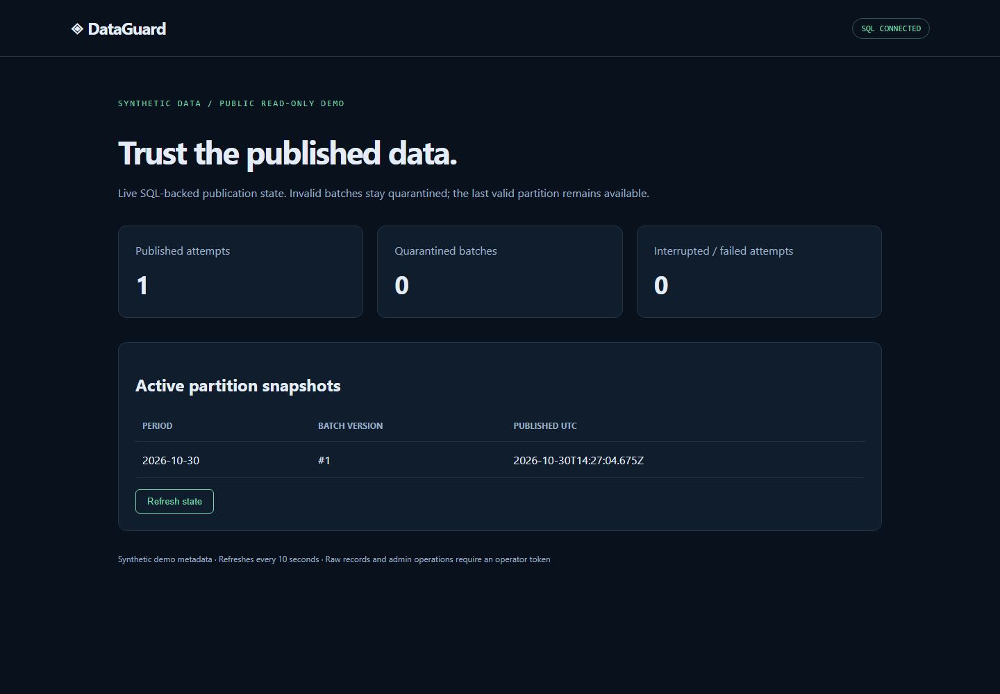
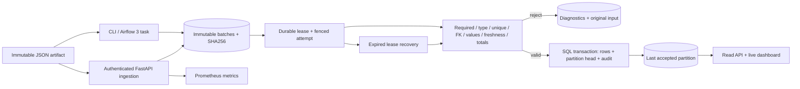

# DataGuard — data pipeline reliability and recovery

[](https://github.com/9059Rohith/dataguard/actions/workflows/ci.yml)

Hosted CI is currently blocked by an account-level runner restriction. [Executed local verification](evidence/verification.md) is recorded separately; no hosted pass is claimed.

A Python/SQL platform that stops invalid settlement batches from replacing a usable dataset. This project demonstrates data engineering contracts, SQL transactions, recovery, orchestration, and deployment operations relevant to OpenFX Data Engineering Intern and DevOps Intern work. It uses synthetic data and makes no claim of affiliation or production use.

**The central invariant:** readers see complete accepted date partitions. Duplicate keys, wrong types, unknown references, stale exports, and mismatched settlement totals are quarantined with diagnostics. A worker killed after row insertion leaves the previous publication visible; retry recovers the exact immutable batch without duplicate rows.





## Run locally

Python 3.12+ is required. SQLite is the zero-dependency local storage option; PostgreSQL 16 is the tested deployment database. PowerShell:

```powershell
python -m venv .venv
.\.venv\Scripts\python.exe -m pip install -r requirements-dev.lock
.\.venv\Scripts\python.exe -m pip install --no-deps -e .
$env:DATAGUARD_TOKEN = python -c "import secrets; print(secrets.token_urlsafe(40))"
.\.venv\Scripts\python.exe -m dataguard.cli init
.\.venv\Scripts\uvicorn.exe dataguard.api:app --host 127.0.0.1 --port 8003
```

Open [the dashboard](http://localhost:8003) or [OpenAPI documentation](http://localhost:8003/docs). In another terminal, with the same database configuration:

```powershell
.\.venv\Scripts\python.exe -m dataguard.cli fixture --rows 100 --output sample.json
.\.venv\Scripts\python.exe -m dataguard.cli stage sample.json --key settlement-export-v1 --run
.\.venv\Scripts\python.exe -m dataguard.cli demo --samples 100 --rows 100 --output evidence/local-benchmark.json
```

The demo inserts valid data, rejects duplicate and malformed batches, starts a child worker, kills that worker with exit code 91 inside an open transaction after row inserts, checks the previous snapshot, waits for its committed lease to expire, recovers, checks exact row counts, then measures real stage/validate/publish latency. `raw_ms` contains every sample; p50/p95/p99 use the nearest-rank estimator. The sample size is intentionally small; this is a reproducible local microbenchmark, not an SLA or capacity claim.

For PostgreSQL and a restricted non-root container:

```powershell
$env:POSTGRES_PASSWORD = python -c "import secrets; print(secrets.token_urlsafe(32))"
$env:DATAGUARD_TOKEN = python -c "import secrets; print(secrets.token_urlsafe(40))"
docker compose up -d --build
$env:DATABASE_URL = "postgresql+psycopg://dataguard:$env:POSTGRES_PASSWORD@127.0.0.1:55434/dataguard?connect_timeout=5"
.\.venv\Scripts\python.exe -m dataguard.cli demo --samples 100 --rows 100 --output evidence/postgres-benchmark.json
```

Compose exposes PostgreSQL on **127.0.0.1:55434** and the dashboard on **127.0.0.1:8003**. Keep the environment variables for subsequent Compose calls; changing `POSTGRES_PASSWORD` does not rotate an existing volume's password. `docker compose down` stops this stack and preserves data. `down -v` deletes this project's database volume; use only for disposable data.

## Contract and API

The contract is executable in `dataguard/contracts.py`, not a prose-only configuration. Exact allowed columns, integer amounts (booleans rejected), nonempty bounded identifiers, per-table primary-key uniqueness, same-batch settlement references, matching currencies, positive trade amounts, allowed currencies, UTC event partition date, export freshness (past 24 hours / future 5 minutes), and per-settlement trade totals are enforced. Inputs have 1–10,000 rows per table and an 8 MB HTTP/staging limit. Amounts are **minor currency units** despite the field name `amount_cents`; no exchange-rate conversion occurs. Historical backfills use an old event period and a freshly produced export. See [contract details](docs/CONTRACT.md).

| Route | Purpose | Access |
|---|---|---|
| `POST /batches` | Stage `{key, payload}`; exact key+payload replay returns same ID | Bearer token |
| `POST /batches/{id}/run` | Validate and atomically publish or quarantine | Bearer token |
| `POST /recover` | Retry staged, failed, or expired-running batches | Bearer token |
| `GET /batches/{id}` | Immutable source, digest, complete attempt history | Bearer token |
| `GET /quarantine` | Last 100 rejected attempts with rule/row/field diagnostics | Bearer token |
| `GET /snapshots/{period}` | Materialized trade and settlement records | Bearer token |
| `GET /summary`, `/snapshots`, `/` | Aggregate state and live read-only dashboard | Private network |
| `/health`, `/ready`, `/metrics` | Process health, DB readiness, Prometheus | Private network |

Missing/short/blank token disables privileged routes with HTTP 503. Incorrect credentials return 401. Idempotency conflict or active worker lease returns 409. Invalid contract data returns a persisted `rejected` result, not a transient HTTP failure. Data correction requires a **new key and immutable batch**, never editing a rejected input. CLI and Airflow are trusted database clients and use database credentials rather than the HTTP token.

Example authenticated publication:

```powershell
$headers = @{ Authorization = "Bearer $env:DATAGUARD_TOKEN" }
$body = @{ key = 'export-2026-10-30-v2'; payload = (Get-Content sample.json -Raw | ConvertFrom-Json) } | ConvertTo-Json -Depth 20
$batch = Invoke-RestMethod -Method Post -Uri http://localhost:8003/batches -Headers $headers -ContentType application/json -Body $body
Invoke-RestMethod -Method Post -Uri "http://localhost:8003/batches/$($batch.batch_id)/run" -Headers $headers
```

## Verify and operate

```powershell
.\.venv\Scripts\python.exe -m pytest -q
.\.venv\Scripts\ruff.exe check .
.\.venv\Scripts\ruff.exe format --check .
.\.venv\Scripts\python.exe -m bandit -r dataguard -ll
.\.venv\Scripts\python.exe -m pip_audit -r requirements.lock --no-deps --disable-pip
# First-time local test DB creation; the suite refuses PostgreSQL names without _test.
docker compose exec postgres psql -U dataguard -d dataguard -c "CREATE DATABASE dataguard_test"
$env:TEST_DATABASE_URL = "postgresql+psycopg://dataguard:$env:POSTGRES_PASSWORD@127.0.0.1:55434/dataguard_test?connect_timeout=5"
.\.venv\Scripts\python.exe -m pytest -q tests/test_pipeline.py
```

See [verification evidence](evidence/verification.md), [implementation ledger](docs/LEDGER.md), [operator runbooks](docs/RUNBOOKS.md), [security model](SECURITY.md), [ADRs](docs/ADR.md), [interview questions](docs/INTERVIEW.md), and [requirements traceability](docs/TRACEABILITY.md). CI runs SQLite and PostgreSQL tests, lint/format, dependency audit, Bandit, actual Airflow 3 DAG import, container build/Trivy scan, and Terraform validation. Optional workflows publish an image or deploy a digest through AWS OIDC only when configured and manually triggered.

The Airflow DAG in `dags/dataguard_pipeline.py` uses the Airflow 3 public `airflow.sdk` API. Its two real tasks stage an immutable mounted artifact and validate/publish it. Trigger with `{"artifact":"exports/day.json","idempotency_key":"settlements-day-v1"}`; initialize the database first and set `DATABASE_URL` plus `DATAGUARD_ARTIFACT_ROOT` on workers. Rejected contract inputs fail the DAG and remain quarantined. Artifact path traversal is rejected. Airflow itself is not bundled into the service image.

## Deployment scope and honest limits

`deploy/kubernetes.yaml` has resource requests/limits, probes, secret references, restricted pod security, no service-account token, and ingress/egress policies. Replace the image and database CIDR, create the Secret out of band, and expose through TLS ingress. [Deployment runbook](docs/DEPLOYMENT.md) includes concrete commands.

`infra/main.tf` provisions a VPC, HTTPS ALB, restricted security groups, private encrypted RDS PostgreSQL with backups and deletion protection, Fargate service with rollback circuit breaker, ECR, CloudWatch, and scoped execution-role secret access. It requires an existing ACM certificate, a Secrets Manager token ARN, trusted ingress CIDR and digest-pinned image. **No AWS resources were created.** Validation is distinct from a deployment; credentials, certificate, domain, image registry and budget are external prerequisites.

This is a small batch platform with intentionally serialized publication. It has no distributed streaming engine, tenant RBAC, automatic data correction, schema migration framework, durable scheduler inside the API, external side-effect exactly-once guarantee, or production SLO claim. PostgreSQL roles, audited retention/archive, TLS identity verification, and larger load tests require deployment-specific work. The global gate provides correctness at modest scale and is an explicit throughput limitation. Recovery scans staged history; very large installations should introduce indexed work queues and partition-scoped fencing. Readers are protected from invalid input, not from loss of the database or a malicious database superuser.
